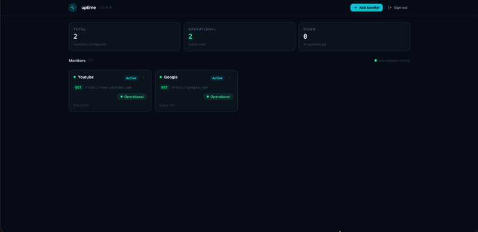

# Uptime Monitor Webapp

Dashboard for the self-hosted uptime monitor. Sign in, add HTTP monitors, and watch live status, 24-hour uptime, latency, and recent checks.

The API and worker live in [uptime-monitor](https://github.com/publiosilva/uptime-monitor). Start Postgres, the API (`http://localhost:3333`), and the worker before using this app.



## Technologies

- React 19 + Vite
- Tailwind CSS
- Apollo Client for GraphQL
- Recharts for latency history
- React Hook Form + Zod for forms

## Prerequisites

- [Node.js](https://nodejs.org/) 22+ and [pnpm](https://pnpm.io/)
- A running [uptime-monitor](https://github.com/publiosilva/uptime-monitor) API on port `3333` and worker on port `3334`

## Local setup

```bash
git clone https://github.com/publiosilva/uptime-monitor-webapp.git
cd uptime-monitor-webapp
pnpm install
pnpm run dev
```

Vite proxies `/api` and `/query` to `http://localhost:3333` during development. Live up/down events come from the worker WebSocket at `ws://localhost:3334/ws/states`.

## Scripts

```bash
pnpm run dev       # start the dev server
pnpm run build     # typecheck and production build
pnpm run preview   # serve the production build
pnpm run lint
```
